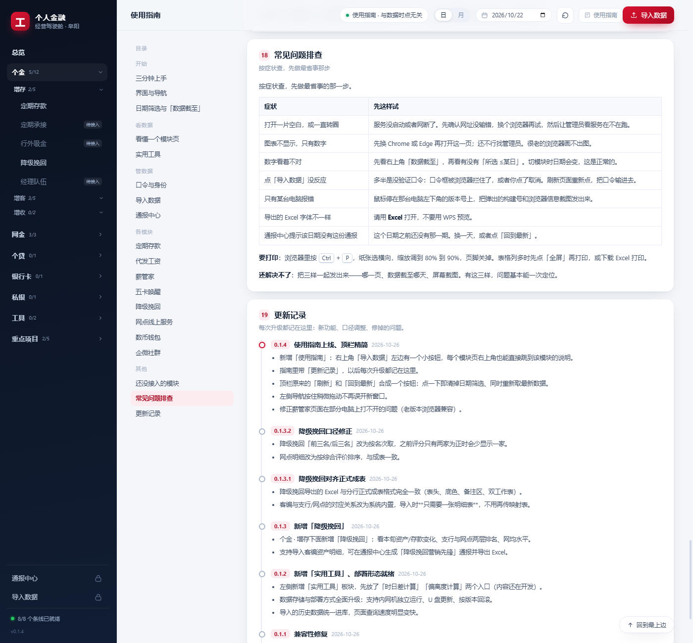

# 阜阳分行 · 个人金融经营驾驶舱

把各条线每天的 Excel 通报，做成一个可浏览、可下钻、按日期查询、可上传、可导出的 Web 系统。

> **这是入口简介，不是维护文档。**
> 现状、架构、数据结构、踩过的坑、自检命令、当前卡点，**一律以 [docs/HANDOFF.md](docs/HANDOFF.md) 为准**；
> 本文件保持简单，不再随版本更新。`docs/archive/` 是历史规划稿，已过时。




## 快速开始

```bash
python run.py                            # 本机 127.0.0.1:8766
python run.py --host 0.0.0.0 --port 8766 # 局域网可访问
```

依赖只有 `openpyxl` / `xlrd`；前端零构建（原生 ES Modules + 本地内置的 ECharts / html2canvas）。
数据在 `data/icbc.db`（SQLite），`data/` 不进版本库。

## 有什么

- 七个板块：个金（增存 / 增客 / 增收）、网金、个贷、银行卡、私银、实用工具、重点项目
- 已接入 9 条数据线，均有支行 / 网点下钻、日 / 月切换（"取该日之前最近一期"）
- 通报中心：表格 + 文案 + Excel + 图片，与正式成表逐格对齐
- 口令准入：「导入数据」「通报中心」按大类验口令，只在本次打开网页内有效
- 使用指南（含更新日志）：页面右上角进入

## 部署

内网麒麟机、无 root、无外网、U 盘更新，代码与数据分离。
完整说明见 **[docs/DEPLOY.md](docs/DEPLOY.md)**。

```bash
bash deploy/install.sh .                                           # 首次
bash ~/icbc-dashboard/bin/update.sh icbc-dashboard-<版本>.tar.gz    # 升级
```

## 新增模块

按 [docs/skills/dashboard-new-module/SKILL.md](docs/skills/dashboard-new-module/SKILL.md)
的固定流程走，改完跑 `python scripts/check_modules.py --write`。
模块总表见 [docs/MODULES.md](docs/MODULES.md)。
