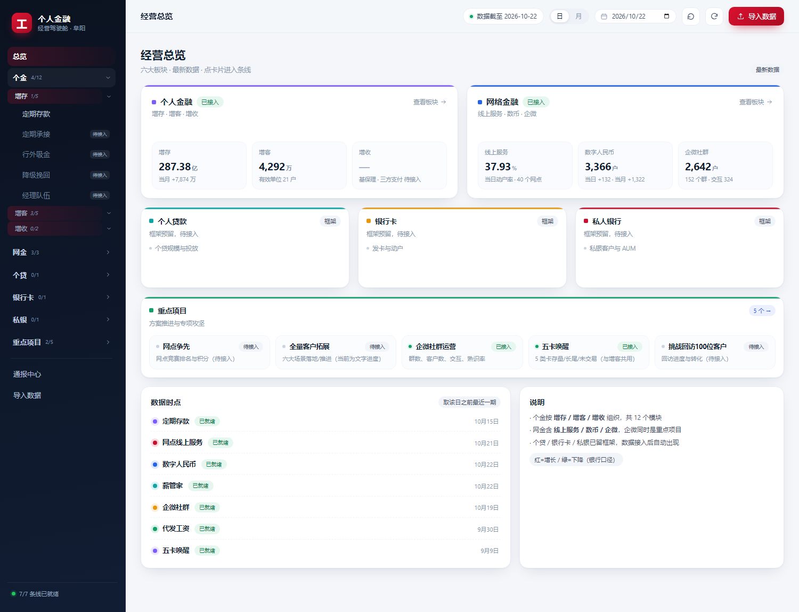
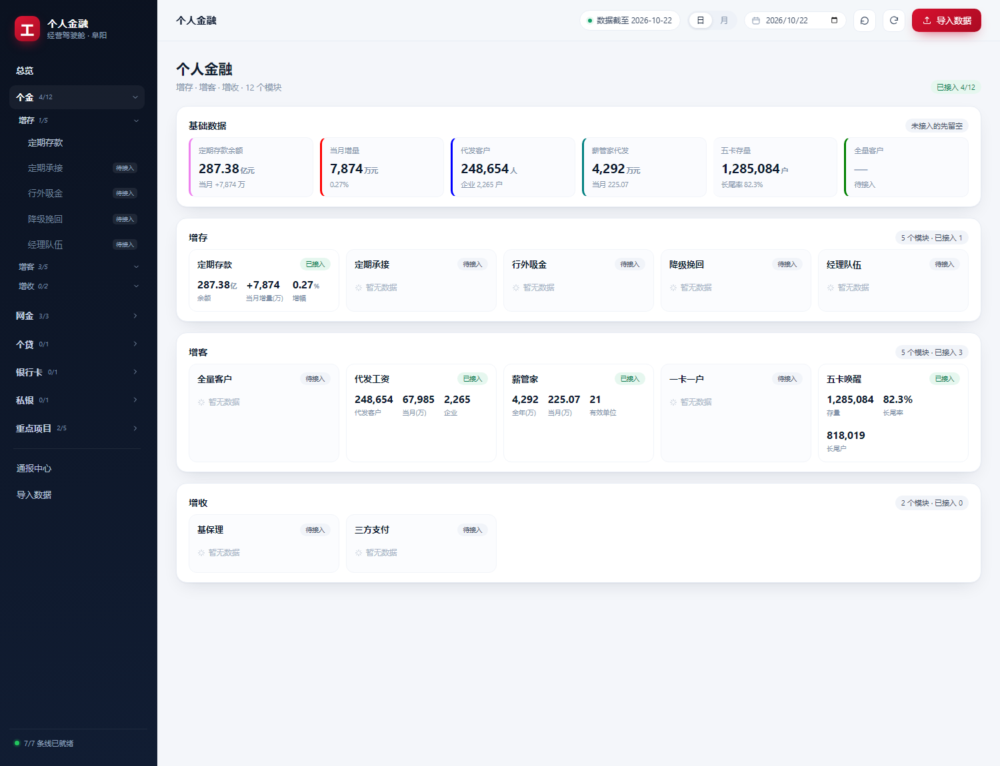
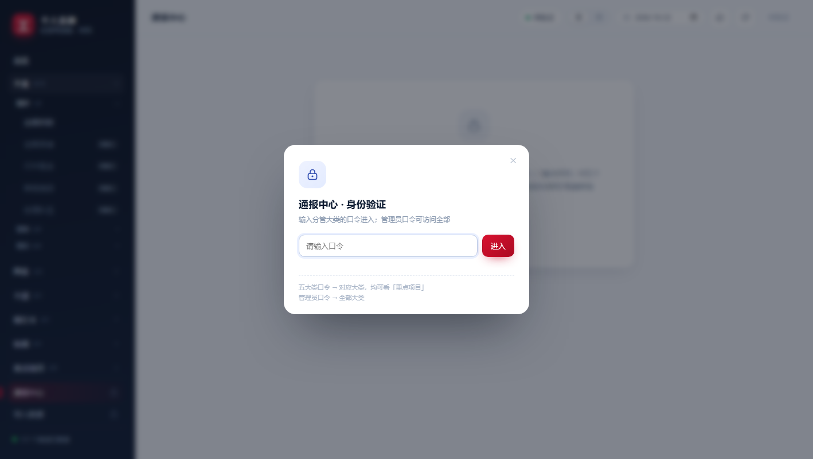

# 阜阳分行 · 个人金融经营驾驶舱

把各条线每天的 Excel 通报，做成一个可浏览、可下钻、按日期查询、可上传、可导出的 Web 系统。

> **接手开发先读 [docs/HANDOFF.md](docs/HANDOFF.md)**：项目全貌、数据结构、踩过的坑、当前卡点、自检命令都在那里。
> `docs/archive/` 下是历史规划稿，**已过时，不要据此判断现状**。



## 快速开始

```bash
cd /home/isee/projects/icbc-dashboard
python run.py                                   # 本机 127.0.0.1:8766
python run.py --host 0.0.0.0 --port 8766        # 局域网可访问
```

依赖只有 `openpyxl` / `xlrd`；前端零构建（原生 ES Modules + 本地内置的 ECharts / html2canvas）。

改完通报逻辑，跑一遍对账；需要备份就顺手跑一下备份：

```bash
python scripts/check_report_parity.py     # 与技能成表逐格对账
python scripts/backup_db.py               # 热备份到 data/backups/（不用停服务）
python scripts/migrate_to_sqlite.py --db-info   # 库现状
```

## 部署（内网麒麟机）

生产环境是**没有 root、没有外网**的内网 Linux，代码和数据分开放在用户目录
（这三个目录由 `install.sh` 在目标机上创建，发布包里没有）：

```
~/icbc-dashboard/
├── current -> releases/<版本>    代码
├── releases/                     每次搬进来的版本
├── shared/data/                  icbc.db / imports / backups（永不随版本覆盖）
└── bin/                          start / stop / status / backup / export-db / update
```

版本号在仓库的 `VERSION`（当前 `0.1.4`）；包名带版本号（`icbc-dashboard-<版本>.tar.gz`），
升级时不会覆盖旧版本，可随时回滚。

```bash
# 首次（U 盘里那个 icbc-dashboard 目录，包里带 seed/ 初始数据）
bash deploy/install.sh .
# 升级（新包，如 icbc-dashboard-0.1.1.tar.gz）
bash ~/icbc-dashboard/bin/update.sh icbc-dashboard-0.1.1.tar.gz
# 日常
bash ~/icbc-dashboard/bin/status.sh
bash ~/icbc-dashboard/bin/backup.sh
bash ~/icbc-dashboard/bin/export-db.sh /media/usb
```

升级会自动备份、在库副本上预演迁移、失败自动回滚；依赖随包走（`vendor/pylib`，纯 Python），
可选内置解释器。完整说明和取舍见 **[docs/DEPLOY.md](docs/DEPLOY.md)**。

## 目录结构

```
src/
  store.py             SQLite 存储层：schema/迁移/快照读写/台账/备份
  viz.py               导入适配层：解析器分发、归档、组装
  server/              app.py（HTTP+路由）/ auth.py（口令）/ api.py（视图模型）/ report.py（通报）
  domain/catalog.py    目录配置：板块→分组→模块（导航/首页/上传/路由都读它）
  ingest/              readers.py（多格式读取）/ payroll.py / fivecards.py
  parsers/             5 个 icbc-* 技能的解析代码（vendor，含 assets）
  compat.py            Python 3.8 垫片（zoneinfo），保证回退路径可用
  version.py           版本号（打包写入 VERSION）
  report/assets/       6 份通报的"样式母版"xlsx + 降级挽回客编映射
  web/                 前端（index.html + assets/{css,js} + vendor/；auth.js 管口令与权限）
vendor/pylib/          纯 Python 依赖（openpyxl/xlrd/PyYAML），随包走、与架构无关
data/                  运行时数据：icbc.db（SQLite）/ imports（原件）/ backups（git 忽略）
scripts/               bootstrap（历史回填）、migrate_to_sqlite（旧 JSON 迁移）、
                       backup_db（热备份）、export_db（对外导出）、selftest（自检）、
                       package_release（打 U 盘包）、check_report_parity（对账）
deploy/                内网机部署脚本（install / update / start / stop / status / backup）
legacy/                v1 单文件版，仅存档，不再维护
```

## 现在能做什么

- **七个板块**：个金（增存/增客/增收，三级导航）、网金、个贷、银行卡、私银、实用工具（时日差/偏离度，待实现）、重点项目
- **8 条数据线**：定期存款、网点线上服务、数币钱包、薪管家、企微社群、代发工资、五卡唤醒、降级挽回
  —— 均有支行/网点下钻、日/月切换（"取该日之前最近一期"）
- **使用指南**：右上角「导入数据」左边的低调入口 + 每个模块页直达该模块说明；
  正文 18 节分「开始 / 看数据 / 管数据 / 各模块 / 其他」，带**更新记录**；不过口令
- **顶栏**：「日/月切换 + 日期选择 + 回到最新（清筛选并刷新）+ 导入数据 + 使用指南 + 身份胶囊」
- **上传**：两级选择（大类 → 模块），支持 xlsx/xls/csv（内容识别，扩展名错了也能认）；
  从模块页右上角「导入数据」进入会自动预选该模块
- **口令准入**：「导入数据」「通报中心」要口令。五个大类各一个口令（都能看「重点项目」），
  另有管理员口令（全量 + 重置口令）。口令只在本次打开网页内有效，刷新即失效；
  详见 [docs/HANDOFF.md 4.5](docs/HANDOFF.md)（含初始口令）
- **通报中心**：线上服务 / 薪管家 / 数币 / 定期 / 企微 / 降级挽回 **六条线**，表格 + 文案 + Excel + 图片，
  与正式成表逐格对齐
- **未接入的模块**：统一占位页（写明需要什么数据），见 HANDOFF 的待办表





## 新增模块

按固定流程走，不要凭记忆改（7 处接线 + 自检 + 模块文档）：

```bash
# 在 fork 出来的会话里直接说 /dashboard-new-module，或看
cat docs/skills/dashboard-new-module/SKILL.md
# 改完必须跑
python scripts/check_modules.py --write     # 接线自检 + 刷新 docs/MODULES.md
python scripts/selftest.py --root data
python scripts/check_report_parity.py
```

模块总表在 [docs/MODULES.md](docs/MODULES.md)，每个模块的源表/口径/坑写在 `docs/modules/<id>.md`。

## 约定

- 数字以**正式通报成表**为准；页面、图片、Excel 三处同源同值
- 顶栏"数据截至"= 当前页面那个模块自己的时点，不是全局最新日期
- 版本号：`0.x` 重大重构 / `0.x.x` 新增模块或功能 / `0.x.x.x` 小修与体验优化；
  发版同时往使用指南的 `changelog.js` 加一条
- 口令只拦「导入数据 / 通报中心」两个管理模块；板块浏览仍然不设门槛
- 数据在 `data/icbc.db`（SQLite，一条线一天一行快照）；比率存小数、保留 6 位
- 备份用 `scripts/backup_db.py`（直接 `cp icbc.db` 会漏掉 WAL 里的最新写入）
- `data/` 不进版本库；整包备份见 HANDOFF 第 9 节
